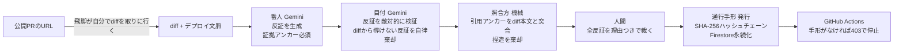

# SEKISHO（関所）

**AIは、承認しない。反証だけを返すデプロイ関所。**

DevOps × AI Agent Hackathon 2026 応募作品（個人開発: 星野宇潮）

  

> **この関所は、作者自身も通しません。** 本リポジトリのデプロイも SEKISHO Gate を通ります —
> [PR #1](https://github.com/USHIKUNDESUYO/sekisho/pull/1) に「通行手形なしでCI失敗 ❌ → 人間が反証を裁いて手形発行 → 再実行で通過 ✅」の実録が残っています。
>
> 🚪 **ライブデモ**: https://sekisho-98982533733.asia-northeast1.run.app （[30秒デモ](https://sekisho-98982533733.asia-northeast1.run.app/?demo=1)）
>
> *見たものには証拠を。見ていないものには、灰を。*

---

## 課題 — AIがコードを書き、AIがLGTMする時代の「責任の空白」

生成AIの普及で、コードの大半をAIが書くチームは珍しくなくなりました。次に来たのは「AIがレビューし、AIが承認する」パイプラインです。速い。しかし本番で事故が起きた朝、こう聞かれて答えられるでしょうか。

> **「この変更、考えたのは誰ですか？」**

AIのLGTMは、事故のあとの「なぜ通したのか」に答えられません。承認をAIに寄せるほど、**人間が考えた形跡**が薄れていく——これはツールの精度の問題ではなく、構造の問題です。

## 解 — 承認する権限を持たないAIエージェント

SEKISHOは、CI/CDパイプラインの前に立つ**関所**です。ふつうのAIレビュアーと逆のことをします。

- **AIは絶対に承認しない。** 合格・点数・LGTMという語彙を構造的に持ちません
- 返すのは **反証だけ**。「この行のリトライは二重課金し得る。証拠はこの行」— 全反証にdiff内の実在行への**証拠アンカー**が付きます
- **人間が全反証を裁く**（対応した／リスク受容／反証が誤り＋理由必須）
- 全件が裁かれて初めて **通行手形**（SHA-256ハッシュチェーンの改竄検知つき証跡）が発行され、GitHub Actionsの関が開きます
- AIは**見ていないもの（灰）を正直に申告**します。網羅率100%の演出はしません

「誰が・いつ・何を根拠に通したか」が、監査に耐える形で必ず残ります。

## エージェント構成 — 番人・目付・照合方

単発のLLM呼び出しではなく、権限を分離した多段エージェントです。



- **飛脚**（機械）: 公開PRのURLを渡すと、diffを自分で取りに行く（GitHub API・公開リポジトリのみ）
- **番人**（Gemini）: diffを読み、署名者が見落としているかもしれない点への反証を生成
- **目付**（Gemini）: 番人の反証を**敵対的に検証**し、誤読・飛躍・一般論の水増しを自律的に棄却（棄却理由はUIに透明表示）
- **照合方**（機械）: 証拠アンカーの引用がdiff本文に実在するか突合し、ハルシネーションを構造的に排除
- どの段も「承認」を出す権限を持ちません。**Fail open for humans, fail closed for AI approval** — 目付が故障しても反証は人間に届き、AIの承認は決して生まれません

## つくる・まわす・とどける

| コンセプト | 実装 |
|---|---|
| つくる | Gemini API（gemini-2.5-flash）による二段エージェント＋Next.js (App Router) |
| まわす | GitHub Actions ゲート（`action/action.yml`）— 通行手形のないdiffはCIで403停止。**このリポジトリ自身が自分の関所で守られています**（`.github/workflows/gate.yml`・PRを開くと実際にゲートが走ります） |
| とどける | **Cloud Run**（Dockerfile / standalone出力）＋ **Firestore**（手形台帳の永続化・ハッシュチェーン） |

## 使い方（3分デモ）

1. トップページでdiffを貼る（「サンプルdiffを読み込む」で架空の決済サービスの変更を投入可能）
2. 「関所に掛ける」→ 番人・目付・照合方の実行トレースと反証3〜5件が返る
3. 各反証を裁く（3択＋理由必須）→ 全件裁くと「通行手形を発行する」が解錠
4. 手形の記録ハッシュ・チェーンを確認、証跡JSONをダウンロード
5. `/ledger` で台帳全体とチェーン検証、`/api/verify` で改竄検知
6. CIからは `GET /api/gate?diffSha256=<hash>` — 手形がなければ403

APIキー未設定の環境では**サンプル応答モード**で全フローが体験できます（画面に明示されます）。

## ローカル起動

```bash
npm install
cp .env.example .env.local   # GEMINI_API_KEY を設定（省略時はサンプル応答モード）
npm run dev
```

## Cloud Run デプロイ

[deploy/cloudrun.md](deploy/cloudrun.md) を参照。`gcloud run deploy --source .` の1コマンドでCloud Buildがビルドしてデプロイされます。Cloud Run上では台帳が自動的にFirestoreに切り替わります。

## GitHub Actions 統合

```yaml
- uses: <this-repo>/action
  with:
    sekisho-url: https://<your-cloud-run-url>
```

## 設計原則（破らない5つの規律）

1. **承認しない** — AIの出力に合格・点数・LGTMの語彙は存在しない
2. **網羅を名乗らない** — 「見ていないもの（灰）」を必ず申告する
3. **証拠のない反証は返さない** — 全反証にdiff実在行のアンカー。照合できなければ棄却
4. **判断は人に、記録は鎖に** — 理由のない裁きでは手形は発行されない。手形はハッシュチェーンで改竄検知
5. **AIの権限は反証まで** — エージェントがどれだけ増えても、承認の権限は与えない

## 名前について

**関所**は、通行手形を検めて人を通した江戸の検問所。手形（証跡）のない者は、どれだけ急いでいても通れませんでした。開発者は公認会計士です。会計監査の世界では「誰が・いつ・何を根拠に判断したか」を残せない記録は証拠になりません。その規律——**AIは結論を書かず、判断と署名は人に残す**——を、デプロイの門に立てたのが本作です。

## ライセンス

MIT
